# What guides judge verdicts?

## Main result

The primary specification is L1 throughout. It incurred no practically meaningful predictive loss relative to L2—accuracy was slightly higher in both representations, while log loss differed by at most 0.0018—and it supplies exact-zero coefficients. L2 is retained only as a sensitivity check.

The analysis supports four conclusions:

1. **Judge verdicts are substantially but not completely predictable.** The raw L1 regression reached 72.59% held-out accuracy and recovered **62.6–80.3%** of empirical repeat-limited accuracy headroom above chance. To obtain orthogonal, separately interpretable axes, we projected the features into one global PCA basis and applied L1 regularisation. This PC GLM still reached 72.70% accuracy and recovered **62.9–80.7%** of the same headroom.
2. **Judges use a direct-quality axis.** PC2—clear, efficient, rigorous and direct responses versus deep, redundant and tool-heavy trajectories—was by far the most important PC. Its Unique effect was 0.141 log-loss units.
3. **Raw rubric features carry the clearest interpretable signal.** The annotation family had a Unique effect of 0.0655. Self-corrections, think-aloud language and hedging were negatively associated with selection; depth, efficiency and rigour were positive.
4. **Failures reflect ambiguous or unstable verdicts, not obvious model-era mismatch.** Prediction error rose by 14.7 percentage points for order-inconsistent verdicts and by 11.2 points when the judge selected the weaker model. Configured-reasoning mismatch and release distance showed no comparable penalty.

## Definitions

- **Unique**: change in held-out log loss when a feature is ablated from the complete model. Positive values mean that ablating it worsens prediction.
- **Singular**: improvement in held-out log loss for the specification containing that feature versus the intercept-only model. Positive values mean that the feature is predictive in its singular specification.
- **Ceiling**: an empirical repeat-agreement proxy from the exact-input rejudge study, not a mathematical Bayes ceiling. Each judge×benchmark cell contains 100 repeated inputs. The conservative endpoint is the Wilson 95% lower bound; the other endpoint is raw historical-to-current agreement.
- **Recovered headroom**: `(held-out accuracy − 0.5) / (ceiling − 0.5)`. Because the ceiling is a range, recovery is also reported as a range.

## Data and evaluation

- Source revision: `LASR-G5/judging@e7f32e3c00f91d699e8c43b53106206bcc72bb22`.
- Six judges and four benchmarks: GPQA, AIME, InterCode and SWE-bench Mini.
- Only pairs for which both candidate answers were correct.
- 16 outer folds: four held-out model groups × four held-out item folds.
- 113,951 held-out predictions per model.
- Raw representation: 137 original features reduced to 112 deterministic correlation composites.
- Scaling order: correlated raw features were merged first, then the final composites were re-scaled separately within each benchmark on representation-training rows. Transcript composites were centered and divided by their SD. The left-minus-right pair composites used by the GLM and PCA were divided by the per-benchmark SD but not re-centered, preserving their antisymmetric difference origin.
- PC representation: one global basis fitted once to 12,423 unique representation-training pairs pooled across all folds and benchmarks. Thirty PCs retain 71.21% of total variance.
- Three inner folds selected `C`; every Unique and Singular fit reused the full model's `C` without retuning.
- Performance and feature-effect intervals use 1,000 item-clustered bootstrap draws. Judge-level failure contrasts use the six judges as replication units and paired t-based 95% intervals.
- Every final and lesion fit converged. All aggregate hashes and the shared global-PC basis were validated.

## 1. Per-judge prediction ceiling

Ceiling endpoints are weighted across each judge's available benchmark cells using the held-out row counts. Recovery is shown for both the raw regression and the orthogonalized PC regression.

| Judge | Empirical ceiling | Raw accuracy | Raw headroom recovered | PC accuracy | PC headroom recovered |
|---|---:|---:|---:|---:|---:|
| Llama 8B | 64.87–74.19% | 62.93% | 53.4–86.9% | 62.91% | 53.4–86.8% |
| DeepSeek R1 | 75.48–83.89% | 75.71% | 75.9–100.9% | 75.50% | 75.3–100.1% |
| DeepSeek V4 | 77.40–85.56% | 73.55% | 66.2–85.9% | 73.30% | 65.5–85.0% |
| Gemma | 83.97–91.15% | 74.21% | 58.8–71.3% | 74.06% | 58.5–70.8% |
| GPT-OSS | 83.05–90.38% | 74.30% | 60.2–73.5% | 74.74% | 61.3–74.9% |
| o4-mini | 83.54–90.79% | 75.19% | 61.8–75.1% | 76.02% | 63.8–77.6% |

The pooled raw-L1 accuracy was 72.59%; against the row-weighted 78.13–86.06% ceiling, it recovered 62.6–80.3% of repeat-limited accuracy headroom. Orthogonalizing 112 correlated features into 30 PCs retained 71.21% of feature variance but essentially all recovered predictive headroom: PC L1 recovered 62.9–80.7%. DeepSeek R1 slightly exceeds the conservative endpoint because that endpoint is a sampled lower confidence bound, not a hard ceiling.

The ceiling study repeats historical inputs on current endpoints. It includes temporal and provider drift as well as stochasticity. The interval should therefore be read as an empirical reliability reference, not an intrinsic upper limit.

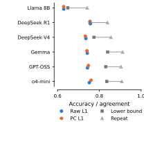

## 2. L1 predictive performance

| Representation | Accuracy (item 95% CI) | Log loss (item 95% CI) | Selected `C` |
|---|---:|---:|---|
| Raw L1 | 0.7259 (0.7161–0.7354) | 0.5424 (0.5286–0.5580) | 0.1 in 16/16 folds |
| PC L1 | 0.7270 (0.7175–0.7365) | 0.5396 (0.5251–0.5561) | 0.1 in 16/16 folds |

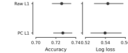

Performance varied much more across judges and benchmarks than between the two L1 representations.

| Judge | Raw accuracy | PC accuracy | Raw log loss | PC log loss |
|---|---:|---:|---:|---:|
| Llama 8B | 0.629 | 0.629 | 0.667 | 0.654 |
| DeepSeek R1 | 0.757 | 0.755 | 0.508 | 0.509 |
| DeepSeek V4 | 0.736 | 0.733 | 0.526 | 0.529 |
| Gemma | 0.742 | 0.741 | 0.520 | 0.523 |
| GPT-OSS | 0.743 | 0.747 | 0.529 | 0.526 |
| o4-mini | 0.752 | 0.760 | 0.501 | 0.492 |

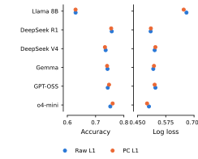

| Benchmark | Raw accuracy | PC accuracy | Raw log loss | PC log loss |
|---|---:|---:|---:|---:|
| AIME | 0.627 | 0.630 | 0.677 | 0.657 |
| GPQA | 0.728 | 0.724 | 0.543 | 0.545 |
| InterCode | 0.716 | 0.720 | 0.556 | 0.551 |
| SWE-bench Mini | 0.779 | 0.774 | 0.465 | 0.468 |

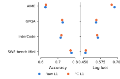

The weakest observed cells involved AIME or Llama 8B. The strongest were GPT-OSS and DeepSeek R1 on SWE-bench Mini (approximately 85% and 84%). AIME lacks DeepSeek R1 and o4-mini, so its aggregate should not be read as a matched judge comparison.

## 3. Interpretable raw features

The leading raw effects under L1 were:

| Feature | Block | Unique Δ log loss (95% CI) | Singular Δ log loss (95% CI) | Population direction |
|---|---|---:|---:|---|
| Self-corrections | Rubric | 0.00537 (0.00259–0.00866) | 0.0206 (0.0140–0.0268) | Negative |
| Think-aloud language / 100 words | Exposition | 0.00421 (0.00303–0.00555) | 0.0108 (0.00588–0.0165) | Negative |
| Hedging count | Surface | 0.00371 (0.00207–0.00542) | 0.00354 (0.00090–0.00646) | Negative |
| Reasoning depth | Rubric | 0.00270 (0.00078–0.00462) | 0.0430 (0.0358–0.0514) | Positive |
| Efficiency | Rubric | 0.00239 (0.00043–0.00444) | 0.0439 (0.0350–0.0525) | Positive |
| Rigour | Rubric | 0.00127 (0.00041–0.00213) | 0.0547 (0.0444–0.0646) | Positive |
| Small-world sigma | Clause descriptors | 0.00122 (0.00045–0.00197) | 0.00709 (0.00287–0.0115) | Positive |
| Any intermediate error / error count | Intermediate errors | 0.00088 (0.00033–0.00150) | 0.00561 (0.00216–0.00923) | Negative |

The direction refers to left-minus-right features: positive means that increasing the feature on the left candidate increased its selection probability conditional on the other predictors.

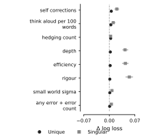

### Group effects

- **Annotations**: Unique 0.0655 (0.0545–0.0781); Singular 0.0998 (0.0885–0.1116).
- **Rubric block**: Unique 0.0418 (0.0336–0.0502); Singular 0.1011 (0.0900–0.1135).
- **Intermediate errors**: Unique 0.00446 (0.00248–0.00665).
- **Hand-engineered text**: Unique 0.00451 (−0.00284–0.0112); Singular 0.0676 (0.0499–0.0830).
- **Clause family**: Unique −0.00403 (−0.00976–0.00119); Singular 0.0437 (0.0278–0.0577).

Clause structure was therefore predictive in its Singular specification but supplied little Unique signal after rubric and response-level features entered.

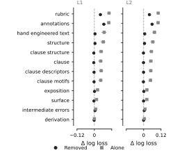

### Judge-specific raw slopes

The judge-specific coefficients sharpen the interpretation:

- Self-corrections were almost neutral for Llama 8B (median slope −0.019 per SD) but strongly negative for the other judges (−0.270 to −0.338).
- Efficiency was almost neutral for Llama 8B (+0.030) but strongly positive elsewhere (+0.318 to +0.381).
- Hedging was likewise nearly neutral for Llama 8B (−0.013) and negative elsewhere (−0.200 to −0.304).
- Think-aloud language was the exception: it was negative for every judge (−0.085 to −0.141).
- Depth and rigour were positive for all judges, again weakest for Llama 8B.

These attenuated Llama slopes accompany its lower repeat agreement and lower predictive accuracy: the weaker judge appears to use the shared quality cues less strongly.

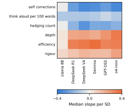

### Benchmark-specific raw Unique effects

The same raw features were not equally useful everywhere:

- Think-aloud language was primarily a GPQA signal (Unique 0.0158; ≤0.0018 elsewhere).
- Self-corrections were strongest on InterCode (0.0084).
- Efficiency was strongest on SWE-bench Mini (0.0081).
- Hedging was strongest on GPQA (0.0061) and InterCode (0.0037).
- Depth was positive on GPQA and InterCode but negative on AIME (−0.0075).

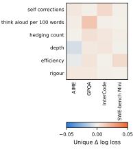

## 4. What the important PCs mean

Component numbers are not interpretations. The table combines each PC's loadings, Unique/Singular effects and fitted direction.

| PC | Variance | Meaning from loading poles | Unique Δ log loss (95% CI) | Singular Δ log loss |
|---|---:|---|---:|---:|
| PC2 | 7.60% | Direct efficiency: sink share, efficiency, clarity, prose and rigour **vs** depth, redundant steps and tool-heavy trajectories | 0.1412 (0.1127–0.1663) | 0.0711 |
| PC3 | 5.41% | Symbolic/backtracking markers and unjustified confidence **vs** rigour, clarity and coherent graph depth | 0.0227 (0.0129–0.0353) | 0.0167 |
| PC5 | 2.87% | Sequential verification, depth, rigour and planning **vs** branched/hub-like structure and unjustified claims | 0.0192 (0.0117–0.0251) | 0.0166 |
| PC4 | 4.10% | Rigorous clarity, efficiency and equations **vs** reasoning errors, unjustified claims and meandering | 0.0153 (0.00952–0.0233) | 0.00078; interval spans zero |
| PC29 | 0.88% | Planned error backtracking, explicit plan coverage and formatted option matching **vs** code, repeated tools and alternative generation | 0.00498 (0.00315–0.00722) | 0.00304 |
| PC22 | 1.04% | Explicit checking, verification and answer restatement **vs** code/maths and option matching | 0.00226 (0.00014–0.00591) | 0.00088; interval spans zero |
| PC1 | 17.65% | Trajectory breadth/length—wide, long, high-fan-out responses **vs** dense/modular, short and sequential structure | 0.00435 (−0.00417–0.0117) | 0.00354; interval spans zero |

PC1 explains the most input variance but contributes no reliable Unique verdict signal. `n_words` is present inside the correlated composite `log chars + n words + tool-call chars`; that composite loads +0.171 on PC1 and is the sixth-largest absolute PC1 loading among 112 inputs. On AIME/GPQA the composite is the equal mean of log characters and word count; on InterCode/SWE it weights log characters and word count at 0.25 each and tool-call characters at 0.5. It was previously visually absent only because the loading figure showed four features per pole. PC2 explains less than half as much variance yet dominates prediction. Variance captured and verdict relevance are therefore different quantities.

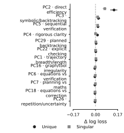

Loading plots: [PC1](../figures/judge-verdict-20260831/pc1-loadings.svg), [PC2](../figures/judge-verdict-20260831/pc2-loadings.svg), [PC3](../figures/judge-verdict-20260831/pc3-loadings.svg), [PC4](../figures/judge-verdict-20260831/pc4-loadings.svg), [PC5](../figures/judge-verdict-20260831/pc5-loadings.svg), [PC6](../figures/judge-verdict-20260831/pc6-loadings.svg), [PC7](../figures/judge-verdict-20260831/pc7-loadings.svg), [PC8](../figures/judge-verdict-20260831/pc8-loadings.svg), [PC22](../figures/judge-verdict-20260831/pc22-loadings.svg), [PC29](../figures/judge-verdict-20260831/pc29-loadings.svg).

Several smaller axes had negative Unique effects: PC16, PC6, PC7, PC18, PC26, PC15 and PC19. Their magnitudes were only 0.0018–0.0055 log-loss units. They likely represent redundant or mildly overfit directions rather than useful Singular predictors.

### Judge-specific PC use

Coefficients below are scaled per one SD of each PC score.

- PC2 was positive for every judge but much weaker for Llama 8B (+0.37) than Gemma (+1.28), DeepSeek V4 (+1.11), o4-mini (+1.10), DeepSeek R1 (+0.98) or GPT-OSS (+0.76).
- PC3 was negative for every judge, from −0.24 for Llama to −0.80 for o4-mini. Judges therefore disfavoured its symbolic/backtracking pole after controlling for the other PCs.
- PC4 was almost neutral for Llama (−0.02) and positive for all other judges (+0.23 to +0.47).
- PC5 was positive for every judge (+0.27 to +0.63).
- PC22 was negative for all non-Llama judges and nearly zero for Llama.
- PC29 was positive for all non-Llama judges and nearly zero for Llama.

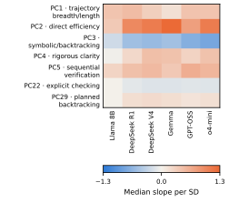

### Benchmark-specific PC use

PC2's aggregate dominance is highly benchmark-specific:

- InterCode Unique effect: **0.2391**.
- AIME: 0.0110.
- GPQA: 0.0036.
- SWE-bench Mini: 0.0131.

Other PCs matter where PC2 does not. PC4 was strongest on AIME and GPQA (0.0314 and 0.0320). PC3 was strongest on GPQA and InterCode (0.0207 and 0.0297). PC5 was positive across all four benchmarks (0.0081–0.0223). PC1 was negative on AIME and small positive elsewhere.

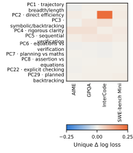

### Benchmark heterogeneity beyond one-benchmark effects

To find variables whose importance changes across domains, every raw feature and PC was ranked by:

`max(max benchmark Unique − min benchmark Unique, max benchmark Singular − min benchmark Singular)`.

This is deliberately different from ranking the largest pooled effect. It detects variables that are useful on both agentic benchmarks but weak on AIME/GPQA, as well as the reverse pattern. The accompanying table also records the mean InterCode/SWE effect minus the mean AIME/GPQA effect.

The strongest raw heterogeneity was mainly Singular:

- **Dense/modular graph structure** (`communities per node + density + max degree share + modularity`) was negative on AIME/GPQA (−0.0150/−0.0632) but positive on InterCode/SWE (+0.0233/+0.0567).
- **Relation/type entropy** was negative on AIME/GPQA (−0.0388/−0.0190) and positive on InterCode/SWE (+0.0637/+0.0180).
- **Adjacent-edge share** was negative on AIME/GPQA (−0.0135/−0.0103) and positive on both InterCode/SWE (+0.0148/+0.0598).
- **Test commands** were near zero on AIME/GPQA and positive on both agentic benchmarks (+0.0041 InterCode; +0.0629 SWE).
- **Response/tool-call length** was negative on GPQA (−0.0677), near zero on AIME/InterCode and positive on SWE (+0.0216).
- **Bare-answer/prose length** separated the families most strongly: negative on AIME/GPQA (−0.0212/−0.0752) and positive on InterCode/SWE (+0.0575/+0.0193).

Thus there is a coherent multi-benchmark agentic pattern: tool/test activity and graph/trajectory structure are useful on both InterCode and SWE-bench Mini even when they are unhelpful on the reasoning benchmarks.

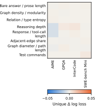

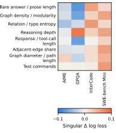

The PC heterogeneity analysis shows complementary axes:

- **PC2 direct efficiency** is uniquely dominated by InterCode, but its Singular effect is positive in every benchmark.
- **PC1 trajectory breadth/length** has a positive Singular effect on InterCode/SWE (+0.0065/+0.0550), is positive on AIME (+0.0168), and negative on GPQA (−0.0431).
- **PC3 symbolic/backtracking** is Singularly useful on AIME/GPQA (+0.0239/+0.0610) but weak or negative on InterCode/SWE (+0.0104/−0.0240).
- **PC6 equations versus verification** is negative on AIME (−0.0415), near zero on GPQA/InterCode and positive on SWE (+0.0204).
- **PC8 assertion versus equations** is positive on AIME/GPQA (+0.0201/+0.0255) and weakly negative on InterCode/SWE.
- **PC29 planned backtracking** is strongest on SWE (+0.0247) and weak elsewhere.

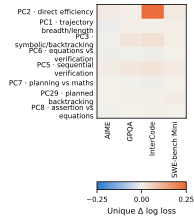

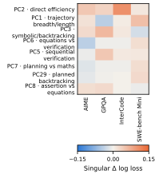

## 5. When verdicts cannot be predicted

The PC-L1 model mispredicted 27.30% of held-out verdicts. Errors were concentrated in genuinely unstable or ambiguous cases.

### Are mispredicted verdicts more often wrong?

Yes. Candidate strength was defined by the saved within-benchmark accuracy target; 4,836 exact ties were excluded.

- When the judge selected the stronger model, prediction error was 22.5%.
- When the judge selected the weaker model, prediction error was 34.5%.
- The paired judge-level increase was **11.2 percentage points** (95% CI 8.1–14.4; N=6 judges).
- Conversely, 49.0% of mispredicted verdicts selected the weaker model, compared with 34.7% of correctly predicted verdicts.

The model is therefore worse at reproducing judge mistakes. This is consistent with incorrect verdicts being noisier or driven by cues not captured in the feature set.

### Reversed-order consistency and cross-judge agreement

- Exact transcript pairs with order-inconsistent verdicts had 38.5% prediction error versus 23.0% for order-consistent verdicts.
- The paired judge-level increase was **14.7 points** (95% CI 8.4–21.0).
- In the lowest cross-judge-consensus quartile, prediction error was 38.9%; in the unanimous-consensus quartile it was 11.9%.

These are the strongest failure diagnostics. The model succeeds when judges make a stable content choice and fails when the target itself is disputed or order-sensitive.

### Capability gap

Near-tied candidates were hard to predict. Error fell from 32.7% in the smallest within-judge capability-gap quartile (mean gap 0.009) to 22.6% in the third quartile (mean 0.094). It rose slightly to 24.3% in the largest-gap quartile, so the relationship is helpful but not perfectly monotonic.

### Configured reasoning and release distance

The proposed distribution-shift explanations were not supported in this dataset:

- Candidate/judge configured-reasoning mismatch changed error by +0.15 points (95% CI −3.15 to +3.44).
- Mixed configured-reasoning candidate pairs changed error by −0.50 points (−1.76 to +0.75).
- Having both candidates newer than the judge changed error by −1.81 points (−5.28 to +1.67; N=5 judges with both strata).
- Within-judge release-distance quartiles had error rates of 26.7%, 28.5%, 28.4% and 24.8%. There was no monotonic degradation as candidates moved further from the judge's release date.
- Candidate-pair release-gap quartiles were similarly non-monotonic: 27.5%, 25.0%, 29.7% and 27.3% error.

Configured reasoning here is a narrow metadata proxy: an explicit reasoning/thinking setting, reasoning parser, or unambiguous reasoning-family name in the pinned model YAML. Absence means that this repository did not explicitly configure or identify reasoning; it does not prove that the model performs no internal reasoning. The judge-visible transcripts excluded hidden reasoning. Release analyses use the pinned release dates for every candidate and judge.

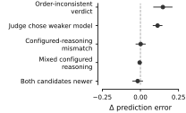

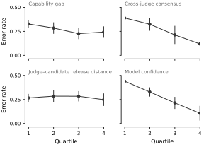

Model confidence behaves as expected: error fell from 44.0% in the lowest confidence quartile to 10.7% in the highest. This is a calibration diagnostic, not an independent explanation.

## 6. Did L1 improve interpretability?

Only partly. Raw L1 retained nonzero population slopes for 75–92 of 112 features per fold (median 81.5). PC L1 retained 22–29 of 30 PCs (median 25.5). Considering judge and benchmark deviations as well, 95 raw features and all 30 PCs were active in every fold.

L1 therefore did not identify a short subset. Its value is that it makes coefficient absence explicit; the Unique/Singular analysis remains the clearer feature-importance summary.

## L2 sensitivity

L2 was not used for the primary story or figures. It had comparable held-out performance:

- Raw L2: accuracy 0.7248; log loss 0.5406.
- PC L2: accuracy 0.7261; log loss 0.5405.

The ordering of Unique effects was highly similar to L1 (Spearman ρ=0.919 for raw features and 0.967 for PCs). The main conclusions—annotation dominance, PC2's role, PC1's weak Unique effect, and small negative effects for several later PCs—do not depend on the penalty.

## Interpretation limits

- Unique and Singular effects are predictive, not causal.
- The feature-effect intervals are not multiplicity-adjusted.
- Coefficient heatmaps show median effective slopes across folds, not separate causal effects by judge.
- Benchmark heatmaps are descriptive weighted means; the judge mix differs for AIME.
- The exact-input agreement reference includes provider and temporal drift and is not a mathematical ceiling.
- “Judge incorrect” uses within-benchmark model accuracy, not an item-level proof that one correct answer was better reasoned.
- Configured-reasoning labels describe pinned settings and unambiguous model families; hidden reasoning was not shown to judges.

## Reproducibility and outputs

Code lineage:

- `d7627a4`: one global PC basis shared across all folds and lesions.
- `12a8977`: ridge sweep expanded around the former lower-bound optimum.
- `2ff0aa2`: initial report builder.
- `49f8cc6`: first committed report; superseded by this interpretation-focused revision.

Key generated tables:

- [`ceiling-by-judge.csv`](../../judge_results/verdict_interpretability/sparse-primary-20260830/tables/ceiling-by-judge.csv)
- [`raw-feature-summary.csv`](../../judge_results/verdict_interpretability/sparse-primary-20260830/tables/raw-feature-summary.csv)
- [`pc-summary.csv`](../../judge_results/verdict_interpretability/sparse-primary-20260830/tables/pc-summary.csv)
- [`important-pc-loadings.csv`](../../judge_results/verdict_interpretability/sparse-primary-20260830/tables/important-pc-loadings.csv)
- [`performance-by-judge-benchmark.csv`](../../judge_results/verdict_interpretability/sparse-primary-20260830/tables/performance-by-judge-benchmark.csv)
- [`l1-coefficients-by-judge.csv`](../../judge_results/verdict_interpretability/sparse-primary-20260830/tables/l1-coefficients-by-judge.csv)
- [`l1-coefficients-by-benchmark.csv`](../../judge_results/verdict_interpretability/sparse-primary-20260830/tables/l1-coefficients-by-benchmark.csv)
- [`l1-unique-effects-by-benchmark.csv`](../../judge_results/verdict_interpretability/sparse-primary-20260830/tables/l1-unique-effects-by-benchmark.csv)
- [`l1-effects-by-benchmark.csv`](../../judge_results/verdict_interpretability/sparse-primary-20260830/tables/l1-effects-by-benchmark.csv)
- [`l1-benchmark-heterogeneity.csv`](../../judge_results/verdict_interpretability/sparse-primary-20260830/tables/l1-benchmark-heterogeneity.csv)
- [`prediction-failure-factors.csv`](../../judge_results/verdict_interpretability/sparse-primary-20260830/tables/prediction-failure-factors.csv)
- [`prediction-failure-quartiles.csv`](../../judge_results/verdict_interpretability/sparse-primary-20260830/tables/prediction-failure-quartiles.csv)
- [`prediction-error-cases.parquet`](../../judge_results/verdict_interpretability/sparse-primary-20260830/tables/prediction-error-cases.parquet)
- [`model-metadata.csv`](../../judge_results/verdict_interpretability/sparse-primary-20260830/tables/model-metadata.csv)

Canonical result directories are `raw-l1`, `raw-ridge-grid`, `pc-l1-global30` and `pc-ridge-global30-grid`. Earlier fold-local PC results and the first ridge grid are excluded from every result above.
