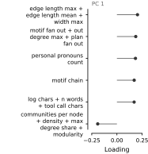
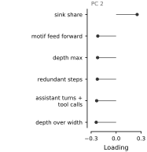

# Judge-verdict feature analysis

## Executive summary

All four prespecified models are complete: raw composites or 30 global principal components (PCs), each fitted with L1 or L2 regularisation. The models were evaluated strictly out of fold over 4 held-out model folds × 4 held-out item folds, giving 113,951 held-out predictions per model.

The main result is not a difference between L1 and L2. It is the feature structure shared across the analyses:

- Raw models depended most strongly on rubric annotations. Removing the full annotation family increased held-out log loss by 0.0655 under L1 and 0.0584 under L2.
- Among individual raw features, self-corrections, think-aloud language, hedging, reasoning depth, efficiency and rigour had the clearest unique effects.
- PC2 dominated the compressed models. Removing PC2 increased log loss by 0.1412 under L1 and 0.1329 under L2, and reduced accuracy by about 7.2 percentage points. PC2 alone recovered about 0.071 log-loss units over the intercept-only model.
- PC2 contrasted clear, efficient and direct responses with deep, redundant, tool-heavy trajectories. Its full-model coefficient was positive in every fold.
- PC1 was not independently important: its drop-one and standalone intervals both included zero under both penalties.
- Clause features were predictive alone but added little unique signal after rubric and other response features were present.
- L1 did not yield a genuinely small model. The raw L1 population slope retained 75–92 of 112 features per fold; PC L1 retained 22–29 of 30 PCs per fold.

No formal test compares L1 against L2 here. Their results are presented as separate regularised views of the same feature-lesion question.

## Design and validation

- Source: pinned `LASR-G5/judging` revision `e7f32e3c00f91d699e8c43b53106206bcc72bb22`.
- Rows: representation-training pairs for which both candidate answers were correct.
- Judges: six judge models.
- Benchmarks: GPQA, AIME, InterCode and SWE-bench Mini.
- Raw basis: 137 original features reduced to 112 correlation composites by deterministic hierarchical grouping at |r| ≥ 0.8.
- PC basis: one global, uncentred basis fitted once to 12,423 unique representation-training pairs pooled across all folds and benchmarks. The first 30 PCs capture 71.21% of total variance.
- Evaluation: 16 outer folds crossing four held-out model groups with four held-out item folds.
- Tuning: each full model selected inverse regularisation strength `C` using three inner folds. Lesions reused that fold's selected `C` and never retuned it.
- Lesions: every raw feature and every PC was removed once and fitted alone once. Raw block and family lesions were also retained.
- Uncertainty: performance intervals are 1,000 item-clustered bootstrap intervals; lesion intervals use the same item-clustered resampling. The performance table also records the more conservative span across model-fold and item-fold summaries.
- Validation: every full fit and lesion fit converged; all 16 fold manifests and all aggregate hashes were checked. Every PC fold used byte-identical loadings and explained-variance tables.

## Full-model performance

| Model | Accuracy (item 95% CI) | Log loss (item 95% CI) | Conservative fold span, accuracy | Selected `C` |
|---|---:|---:|---:|---|
| Raw L1 | 0.7259 (0.7161–0.7354) | 0.5424 (0.5286–0.5580) | 0.7087–0.7369 | 0.1 in 16/16 folds |
| Raw L2 | 0.7248 (0.7148–0.7344) | 0.5406 (0.5283–0.5548) | 0.7067–0.7351 | 0.005 in 11 folds; 0.01 in 5 |
| PC L1 | 0.7270 (0.7175–0.7365) | 0.5396 (0.5251–0.5561) | 0.7133–0.7360 | 0.1 in 16/16 folds |
| PC L2 | 0.7261 (0.7164–0.7354) | 0.5405 (0.5271–0.5559) | 0.7111–0.7362 | 0.005 in 1 fold; 0.01 in 12; 0.05 in 3 |

The four overall accuracies lie between 72.48% and 72.70%. This narrow descriptive range is smaller than the variation across judges and benchmarks. Accuracy was about 62.9–63.4% for Llama-3.1-8B-Instruct and 74.8–76.0% for o4-mini, depending on specification. AIME was the hardest benchmark (60.1–63.0%); SWE-bench Mini was the easiest (76.7–77.9%). These strata are descriptive because their rows and judge availability differ.

*Points are held-out estimates; intervals are 95% item-clustered bootstrap intervals. L1 and L2 are shown separately, not tested against each other.*

## Raw feature effects

Positive drop-one values mean that removing the feature worsened held-out prediction. The largest unique effects were:

| Feature | Raw L1 Δ log loss (95% CI) | Raw L2 Δ log loss (95% CI) | Median population direction |
|---|---:|---:|---|
| Self-corrections | 0.00537 (0.00259–0.00866) | 0.00450 (0.00250–0.00668) | Negative |
| Think-aloud language per 100 words | 0.00421 (0.00304–0.00555) | 0.00312 (0.00221–0.00418) | Negative |
| Hedging count | 0.00371 (0.00207–0.00542) | 0.00342 (0.00199–0.00484) | Negative |
| Reasoning depth | 0.00270 (0.00078–0.00462) | 0.00285 (0.00121–0.00458) | Positive |
| Efficiency | 0.00239 (0.00043–0.00444) | 0.00211 (0.00040–0.00387) | Positive |
| Rigour | 0.00127 (0.00041–0.00213) | 0.00111 (0.00035–0.00189) | Positive |

Because predictors are left-minus-right differences, a negative coefficient means that increasing that feature on the left response reduced the probability that the judge chose the left response, conditional on the remaining model. Both penalties therefore associate self-correction, think-aloud language and hedging with lower judge preference, while depth, efficiency and rigour point in the positive direction.

The unique effects are much smaller than the corresponding standalone effects. For example, rigour alone improved log loss over the intercept-only model by 0.0547 under L1 and 0.0534 under L2. Clarity, efficiency and depth were similarly strong alone. This gap between standalone and drop-one effects is evidence of shared or redundant predictive information, not evidence that the smaller drop-one effects are unimportant.

*Black circles show the change after removing a feature from the full model; grey squares show improvement when that feature is fitted alone relative to the intercept-only model. Intervals are item-clustered 95% bootstrap intervals.*

## Grouped raw effects

The annotation family was the clearest source of unique raw signal:

| Group | Raw L1 removal Δ log loss (95% CI) | Raw L2 removal Δ log loss (95% CI) |
|---|---:|---:|
| All annotations | 0.0655 (0.0545–0.0781) | 0.0584 (0.0485–0.0697) |
| Rubric block | 0.0418 (0.0336–0.0502) | 0.0399 (0.0324–0.0478) |
| Intermediate-error block | 0.00446 (0.00248–0.00665) | 0.00397 (0.00245–0.00579) |
| Hand-engineered text family | 0.00451 (−0.00284–0.0112) | 0.00737 (0.00116–0.0134) |
| Structure block | 0.00445 (−0.00084–0.00971) | 0.00630 (0.00142–0.0110) |

Rubric features alone improved log loss by about 0.101 under both penalties. Clause descriptors and motifs were also predictive alone (roughly 0.044–0.049), but removing the whole clause family from the complete raw model did not worsen held-out performance: Δ log loss was −0.0040 under L1 and −0.0010 under L2, with both intervals spanning zero. Clause structure therefore appears to overlap substantially with rubric, structure and other response-level signals.

Planning was a small counterexample: removing its block improved log loss by about 0.001 under both penalties. The magnitude is tiny, but it is consistent with mild redundant or noisy contribution after the other features enter.

## Global PC effects

PC2 is the central compressed predictor:

| Component | PC L1 removal Δ log loss (95% CI) | PC L2 removal Δ log loss (95% CI) | Standalone Δ log loss, L1 / L2 |
|---|---:|---:|---:|
| PC2 | 0.1412 (0.1127–0.1663) | 0.1329 (0.1060–0.1565) | 0.0711 / 0.0715 |
| PC3 | 0.0227 (0.0129–0.0353) | 0.0224 (0.0133–0.0344) | 0.0167 / 0.0173 |
| PC5 | 0.0192 (0.0117–0.0251) | 0.0198 (0.0133–0.0249) | 0.0166 / 0.0163 |
| PC4 | 0.0153 (0.00952–0.0233) | 0.0140 (0.00822–0.0219) | 0.00078 / 0.00253; intervals cross zero |
| PC29 | 0.00498 (0.00315–0.00722) | 0.00419 (0.00273–0.00579) | 0.00304 / 0.00266 |
| PC1 | 0.00435 (−0.00417–0.0117) | 0.00640 (−0.00086–0.0138) | 0.00354 / 0.00434; intervals cross zero |

Removing PC2 reduced held-out accuracy by 7.19 percentage points under L1 and 7.28 points under L2. Its median population coefficient was positive in both models: 0.192 under L1 and 0.238 under L2, corresponding to median population odds ratios of 1.21 and 1.27 per unit of the globally defined PC score.

PC2 loads positively on sink share, efficiency, clarity, prose share, relation/type entropy, source share and rigour. It loads negatively on depth-over-width, assistant/tool-call count, redundant steps, maximum depth, feed-forward tool motifs, clustering/transitivity and repeated tool continuation. It is therefore best read as a direct, clear and efficient response axis opposed to deep, redundant and tool-heavy trajectories.

PC1 instead loads on response size and graph breadth: edge length/width, fan-out, personal pronouns, chain motifs, response/tool-call length and long graph edges. Its negative end includes dense/modular graph structure and bare-answer/prose-length structure. Despite explaining the most raw variance, PC1 supplied little reliable unique verdict signal once the remaining PCs were present.

Several later PCs had negative drop-one effects: removing PC6, PC7, PC15, PC18 and PC19 slightly improved held-out log loss under both penalties. PC16 was additionally negative under L1. These are small effects and were not multiplicity-adjusted, but they show that retaining variance is not the same as retaining useful out-of-fold predictive signal.

## Did L1 improve interpretability?

Only partially. L1 made individual hierarchical coefficients exactly zero, but it did not reduce either model to a short feature list:

- Raw L1 retained a nonzero population slope for 75–92 of 112 features per fold (median 81.5). Sixteen raw population slopes were nonzero in all 16 folds, and 111 appeared in at least one fold.
- PC L1 retained 22–29 of 30 population slopes per fold (median 25.5). Nine PCs—PC1, PC2, PC3, PC4, PC5, PC9, PC22, PC27 and PC29—were nonzero in every fold.
- Considering any population, judge, benchmark or judge-by-benchmark coefficient, 95 raw features and all 30 PCs were active in every fold.

The richer hierarchical deviations are the reason base-feature selection remains broad. L1 is still useful for showing which individual coefficients collapse to zero, but lesion effects are the clearer importance measure here. In particular, the intended focus on PC1/PC2 resolves sharply: PC2 is dominant and PC1 is weak.

## Interpretation limits

- Lesions measure predictive contribution, not causality.
- A negative drop-one effect can reflect redundancy, suppression or overfit; it does not mean that the underlying behaviour is intrinsically beneficial.
- The item-clustered intervals do not correct for testing 112 raw features or 30 PCs.
- PC signs are conventional. Their meaning comes from the fixed loading direction saved with the global basis.
- The same representation-training data define the global PCA basis and support model fitting. Generalisation is evaluated through held-out model/item folds, not through a separately collected representation dataset.

## Reproducibility and files

Canonical code commits:

- `d7627a4`: one global PCA basis shared across all folds and lesions.
- `12a8977`: expanded ridge sweep around the former lower-bound optimum.
- `2ff0aa2`: introduced the lean final table/figure builder; its final layout refinements are committed with this report.

Primary generated tables:

- [`performance.csv`](../../judge_results/verdict_interpretability/sparse-primary-20260830/tables/performance.csv)
- [`effects.csv`](../../judge_results/verdict_interpretability/sparse-primary-20260830/tables/effects.csv)
- [`l1-selection-frequency.csv`](../../judge_results/verdict_interpretability/sparse-primary-20260830/tables/l1-selection-frequency.csv)
- [`pc1-pc2-loadings.csv`](../../judge_results/verdict_interpretability/sparse-primary-20260830/tables/pc1-pc2-loadings.csv)
- [Global PCA explained variance](../../judge_results/verdict_interpretability/sparse-primary-20260830/global-pc-basis/explained-variance.csv)

Canonical result directories under `judge_results/verdict_interpretability/sparse-primary-20260830/` are `raw-l1`, `raw-ridge-grid`, `pc-l1-global30` and `pc-ridge-global30-grid`. Earlier fold-local PC results and the first ridge grid are superseded and excluded from every table, figure and statement above.
